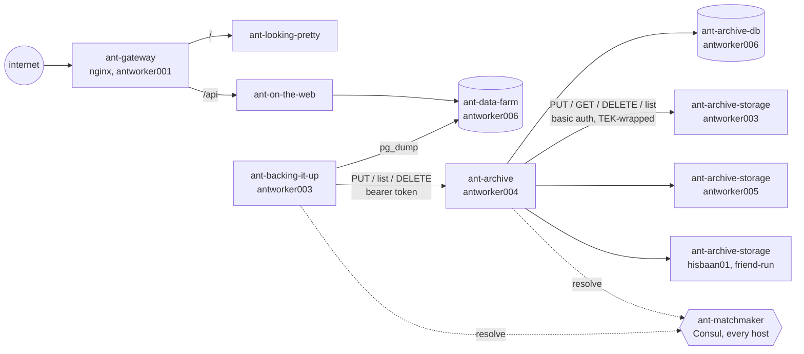
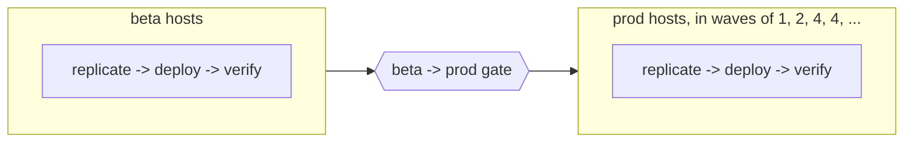
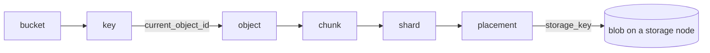
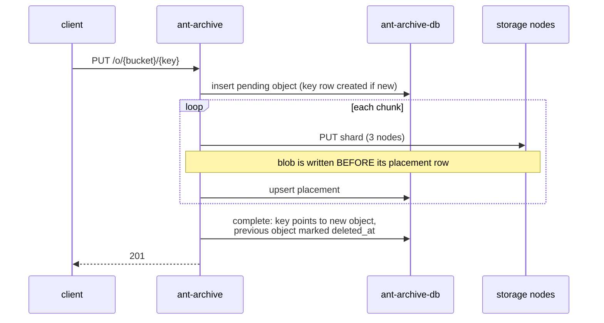
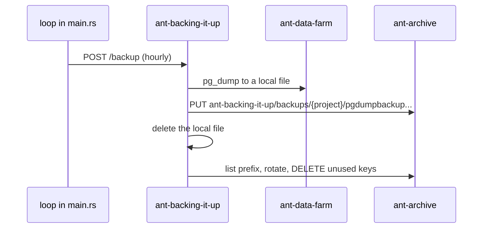

# Design: storage and backups

How the backup and object storage services fit together. For the platform
(build, secrets, systemd, Consul) see [docs/platform.md](docs/platform.md); for
the wider service list see [docs/developer-guide.md](docs/developer-guide.md).

Everything here is checked against code and `services.json` as of 2026-11-08.

## System diagram

- The gateway only proxies the website and its `/api`. **ant-archive and the
  storage nodes are not on the internet**; they are reachable on the flat
  internal network, where every service does its own auth.
- Services find each other through Consul (`ant-matchmaker`). Storage nodes
  outside the home network are registered by hand, see
  [docs/adding-remote-ant-archive-storage.md](docs/adding-remote-ant-archive-storage.md).
- `ant-fs` (antworker004, hisbaan01, greg01) and `ant-backing-it-up-db` are
  retired. They hold backups from before the move to ant-archive, which the
  `fetch-backup` binary can still restore.

## Hosts

From `services.json`. Only the services relevant here:

| Host         | Owner  | Runs                                                         |
| ------------ | ------ | ------------------------------------------------------------ |
| antworker001 | home   | ant-gateway, ant-on-the-web                                  |
| antworker003 | home   | ant-backing-it-up, ant-backing-it-up-db, ant-archive-storage |
| antworker004 | home   | ant-archive, ant-fs                                          |
| antworker005 | home   | ant-archive-storage                                          |
| antworker006 | home   | ant-data-farm, ant-archive-db                                |
| hisbaan01    | friend | ant-archive-storage, ant-fs                                  |
| greg01       | friend | ant-fs, nextcloud-webdav                                     |

Every home host also runs ant-host-agent and an ant-matchmaker agent.

## Deployment

`services.json` is the source of truth for what runs where. It is read by:

- `ant_library::services::Services`, the shared model. A host with
  `inactive: true` or `auto_deployable: false` is skipped for builds and
  deployments.
- `anthill build` (`ah build`), to decide which architectures to build a project
  for: those of the deployable hosts that list it.
- `ant-zookeeper`, the deployment service, to decide which hosts get a new
  version (`routes/service.rs`, `pipeline/dag.rs`).
- `scripts/lib.sh`, for the shell deploy scripts.

When ant-zookeeper has artifacts of one version for every architecture a project
needs, it activates the revision and builds a pipeline:

- **Replicate** unpacks the build tarball, injects `.env` (including the
  instance's `additional_vars`) and a `VERSION` file, and sends it to the host.
- **Deploy** calls `enable_service` on the host's ant-host-agent (port 3232),
  which installs to `~/service/<service_id>/<version>/` and restarts the systemd
  unit.
- Each project has its own pipeline, so ant-archive and ant-archive-storage
  deploy independently, in no fixed order.
- Friend-run hosts (`hisbaan01`, `greg01`) are `auto_deployable: false`, so they
  never get automatic deployments. Their services are updated by hand.
- The pipeline's database migration step is not implemented
  (`event_loop/migrate_db.rs`). Database projects run their migrations through
  `docker-entrypoint-initdb.d` on first start, and afterwards by hand with
  `projects/<db>/scripts/migrate.sh <env>` (`scripts/migrate.sh`), which applies
  files above the highest `migration_seq`.

## ant-archive: object storage

ant-archive is the router. It authenticates clients, encrypts, splits objects
into chunks and places copies on storage nodes. It keeps all metadata in
ant-archive-db. Storage nodes only hold bytes.

### Data model

- **Key**: the name a client uses. Points to at most one current object.
- **Object**: one uploaded version. A key overwritten twice has three objects.
- **Chunk**: a fixed-size slice of an object (4 MB in prod, 10 bytes in tests),
  so reads and writes use constant memory.
- **Shard**: what the redundancy scheme makes of a chunk, one per node. The
  `RedundancyScheme` trait covers replication and erasure coding; only
  `replication` with 3 copies is implemented.
- **Placement**: one shard on one storage node, under `storage_key`
  (`{object_id}-{chunk_index:08}-{shard_index}`).

### What `deleted_at` means

Every table has `deleted_at`; it means something different at each level.

| Table                            | Set when                          | Means                                                                     |
| -------------------------------- | --------------------------------- | ------------------------------------------------------------------------- |
| `archive_key`                    | client DELETEs the key            | key hidden from GET and listing. Cleared when the key is uploaded again   |
| `archive_object`                 | its key is deleted or overwritten | object is deletable from this moment; the vacuum grace period starts here |
| `archive_placement`              | the vacuum removed the blob       | blob is gone from the node; no longer counts towards node usage           |
| `archive_chunk`, `archive_shard` | never                             | unused                                                                    |

An object is **referenced** while some key's `current_object_id` points to it.
Everything else (deleted keys, overwritten versions, abandoned uploads) is
garbage for the vacuum.

### Encryption

See [projects/ant-archive/README.md](projects/ant-archive/README.md). In short:
each object has its own data key (DEK), stored in the DB encrypted by a key
encryption key (KEK). Chunks are encrypted with the DEK, then wrapped with a
per-request transport key (TEK) on the way to the storage node, which checks and
discards it. Storage nodes never see plaintext or the DEK. Because every object
has its own DEK, identical data is never deduplicated.

### Placement and capacity

Each storage node has a `capacity_bytes` in `archive_storage_node`, counted in
shard bytes. A node qualifies for a new object while
`bytes_stored_on_node + bytes_per_node <= capacity_bytes`. Capacity `0` or
`is_active = false` takes a node out of placement.

- `bytes_per_node` is what one node stores for the object: for each chunk the
  chunker will produce (`Chunker::ciphertext_sizes`, plaintext plus a 16-byte
  AES-GCM tag), one shard of `RedundancyScheme::shard_size` bytes.
- `bytes_stored_on_node` sums `archive_shard.shard_size_bytes` over every
  placement on the node not yet purged, including garbage, because garbage is
  still on disk until the vacuum removes it.
- Files on the node are slightly larger than shard bytes: the transport
  encryption adds 28 bytes and the blob format 1 byte per blob.

### Uploads

A failed write to a node retries on a replacement node, which can leave a
partial blob on the failed node with no placement row. The vacuum's orphan pass
cleans those up.

### Reads

For each chunk, ant-archive fetches shards (data shards first) until it has
`min_shards_to_reconstruct` good ones. A shard is skipped, and the next node
tried, when the node is not in service discovery, when a request to the node
fails, when the node has no blob for it, or when its SHA-256 doesn't match the
checksum recorded at upload. The chunk is then decrypted with AES-GCM, which also
rejects tampered or truncated data.

### Vacuum

`POST /vacuum` (any valid bearer token) and a loop in `main.rs` every 10 minutes
both call `routes::vacuum::vacuum`. It is a reconciliation loop: each pass moves
the storage nodes towards what the DB says, and anything it can't finish is
retried by a later pass.

1. **Purge garbage.** For each placement of an unreferenced object untouched for
   longer than the grace period (1 hour in prod), delete the blob by
   `storage_key` and set the placement's `deleted_at`. A 404 counts as gone.
2. **Delete orphans.** For each node, list its blobs (by hash) and delete any
   whose hash matches no unpurged placement, once older than the grace period.
   The grace period protects uploads in progress, whose blob exists before its
   placement row.
3. **Skip when idle.** A pass skips if `last_activity` in the DB is unchanged
   since the last pass and that pass left nothing deferred or failed.

ant-archive instances are interchangeable routers, so the vacuum's state lives
in the `archive_job` row `vacuum` in ant-archive-db, not in memory. A pass first
takes the row's lease for its `instance_id`; if another instance holds an
unexpired lease, it reports `already_running` and does nothing. The lease lasts
an hour, so a crashed instance's lease is taken over after that. Releasing the
lease records the `last_activity` the pass saw and whether it was clean, which
the next pass on any instance uses to decide whether to skip.

Node failures are reported in the response and retried; only DB errors fail the
pass.

## ant-archive-storage: storage nodes

See
[projects/ant-archive-storage/README.md](projects/ant-archive-storage/README.md).
Blobs live at `blobs/{h[0..2]}/{h[2..4]}/{h}` where `h = sha256(storage_key)`.
The key itself is not stored, so `GET /` lists hashes (sorted, paginated with
`after` and `limit`) and `DELETE /blobs/{hash}` deletes by hash. Callers use
HTTP Basic auth against `ant_archive_storage_auth.secret`.

Assume a storage node can be offline, or lose its data, at any time,
especially friend-run ones. Corruption is caught on read by the shard checksums.

## ant-backing-it-up: database backups

Rotation (`src/slots.rs`, `src/rotation.rs`) keeps the newest backup in each of
the 6 most recent hours, 4 six-hour blocks, 7 days, 5 weeks and 6 calendar
months that have a backup (UTC; weeks start Thursday, aligned to the Unix
epoch). At most 28, about 21 in steady state. Periods are fixed windows of time,
so a backup deleted now is never one a later run would want, and if backups
stop, nothing is rotated away. `POST /clean` runs rotation alone.

Deleting a backup only soft-deletes its key in ant-archive; the space comes back
when the ant-archive vacuum purges it. For a database that dumps to 500 MB,
expect about 12 GB of backups, so about 36 GB of raw disk across storage nodes
with 3 copies.

## Conventions seen in this area

- Errors are logged with an `ANT-ERR-NNN` code that is unique across the whole
  repo, one per call site, so a log line leads to exactly one place. A new code
  takes the highest number in use plus one.
- `.expect()` is for invariants the compiler can't prove. Anything that can
  actually fail maps to an error that becomes a 500.
- Code is formatted with `cargo fmt`, which uses each crate's edition.
- Integration tests run real services: an embedded Postgres, a Consul agent, and
  real storage nodes on local ports
  (`ant-archive/tests/integration/fixture.rs`).
- Where a real dependency is too heavy, a trait with an in-memory fake is used
  (`EmailSender`, `Dns`, `BackupStore`).
